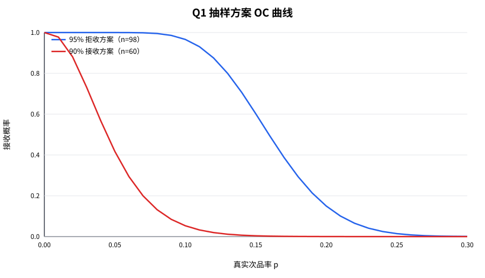
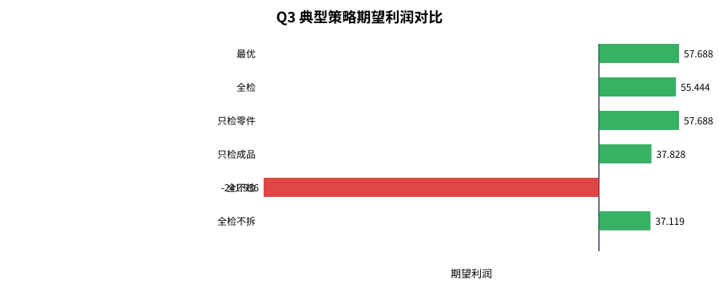
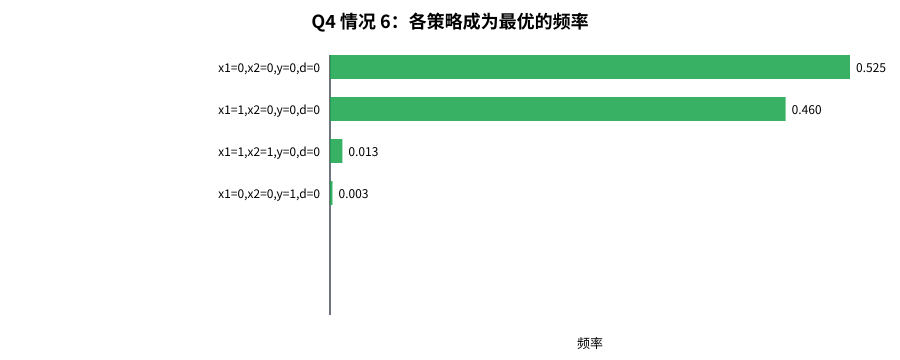

# CUMCM 2024 B：生产过程中的决策问题

2024 年全国大学生数学建模竞赛 B 题的可复现实现：抽样检测方案、两零件生产决策、多工序生产决策，以及次品率由抽样估计时的贝叶斯决策。

> 说明：这不是官方标准答案。题目对“检测次数尽可能少”的精度、拆解后是否重新检测等细节没有完全指定，不同假设会得到不同数值。本仓库把假设写清楚，并给出可运行的代码、结果和蒙特卡洛校验，便于复现与讨论。

---

## 0. 结论速览

| 问题 | 主要结论 |
|---|---|
| Q1 抽样 | 5% 误差下，95% 拒收方案 n=98；90% 接收方案 n=60。精确二项检验的判定线分别是“≥16 件判拒收”“≤2 件判接收”。若要求 80% 功效，样本量分别约为 270 和 128。SPRT 的期望检测次数更少。 |
| Q2 两零件 | 6 种情况的最优策略分别为：不检/不检/不检成品/拆解；检/检/不检成品/拆解；不检/不检/检成品/拆解；全检/拆解；不检/检/不检成品/拆解；全不检/不拆解。 |
| Q3 多工序 | 最优为“8 个零配件全检、3 个半成品不检、成品检并拆解”，期望利润 57.688。全检方案 55.444；“只检零件”与最优几乎相同。 |
| Q4 不确定性 | 次品率由抽样估计时，Q2 情况 6 的最优策略会从“全不检”转为“检零配件 1”，用 0.35 的期望利润换取更好的下行风险；Q3 的最优策略在“检半成品/检成品”之间切换，利润差仅 0.02。 |

---

## 1. 快速开始

环境：Python 3.12，依赖 pandas、numpy、openpyxl。

~~~bash
pip install -r requirements.txt

# 运行 Q1-Q4
python main.py

# 跳过较慢的 Q4
python main.py --skip-q4

# 运行测试
python -m unittest discover -s tests -v
~~~

输出在 outputs/：

- q1_results.json、q1_oc_curve.csv
- q2_all_strategies.csv、q2_best.csv、q2_validation.csv、q2_results.json
- q3_top_strategies.json、q3_results.json
- q4_q2.json、q4_q3.json
- figures/q1_oc.svg、q3_strategies.svg、q4_case6_freq.svg

---

## 2. 问题拆解

题目中的生产流程可以写成：

~~~text
零配件采购 → 零配件检测/替换 → 装配 → 成品检测 → 销售
                                      ↓
                          不合格品：拆解重装 或 报废
                                      ↓
                          售出后退回：调换 + 拆解/报废
~~~

四个子问题：

1. Q1：供应商声称次品率不超过标称值，设计检测次数尽可能少的抽样方案。
2. Q2：两种零配件、一道装配工序，决定是否检测零配件、是否检测成品、是否拆解不合格品。
3. Q3：m 道工序、n 个零配件，重复 Q2 的决策；给定 2 道工序、8 个零配件、3 个半成品的数据。
4. Q4：零配件、半成品、成品的次品率不是已知常数，而是抽样估计值，重新做 Q2、Q3。

---

## 3. 核心建模思想

把“生产一件合格成品并完成销售”看成一个更新过程：

- 每进行一次生产尝试，支付零配件、装配、检测等成本；
- 如果产出合格品，流程结束；
- 如果产出不合格品，按决策拆解或报废，然后重新尝试；
- 对售出后退回的产品，支付调换损失，再进入拆解/报废流程。

因此，目标不是“把每一次生产的成本算到最小”，而是：

~~~text
max  期望利润 = 市场售价 P - 交付一件合格品的期望总成本 V0
~~~

决策变量：

- x_i ∈ {0,1}：是否检测第 i 个零配件；
- y ∈ {0,1}：是否检测成品；
- d ∈ {0,1}：检测出的不合格成品是否拆解。

Q3 中，每个半成品也有自己的检测、拆解决策。

---

## 4. 模型假设

为了让模型可计算、可复现，作如下假设：

1. 独立性：各零配件是否为次品、各道装配是否产生次品，相互独立。
2. 检测即替换：零配件检测发现次品后，丢弃并购买新件，直到得到合格件；期望成本为 (p_i+c_i)/(1-r_i)。
3. 拆解后重新检测：不合格品拆解后，对其所有子件重新检测，次品替换为合格件，再重新装配。
   - 这是本模型最关键假设。若严格“重复步骤(1)”且原本决定不检测某零件，则拆解后可能反复装配同一个次品，形成死循环。重新检测是避免死循环、保证流程收敛的一种建模方式。
4. 拆解后的子件修复：若子件是不合格半成品，选择“报废并重新生产”与“拆解并修复其子件”中成本较低者。
5. 调换损失 L：L 是每件售出不合格品带来的额外损失（物流、信誉等）；调换品的生产成本通过重装/重启流程单独计入，不包含在 L 中。
6. Q3 结构：按赛题图 1，半成品 1 由零配件 1-3 装配，半成品 2 由零配件 4-6 装配，半成品 3 由零配件 7-8 装配。

---

## 5. 问题一：抽样检测方案

### 5.1 两种判定方向

标称值 p0=10%。

- 情形 (1)：95% 信度下认定 p>p0，则拒收。
  - 单侧检验：H0: p≤p0，H1: p>p0，显著性水平 α=0.05。
  - 拒绝域：样本中次品数 X≥c。
- 情形 (2)：90% 信度下认定 p≤p0，则接收。
  - 单侧检验：H0: p≥p0，H1: p<p0，显著性水平 α=0.10。
  - 接收域：X≤c。

### 5.2 正态近似方案

取误差 δ=5%，样本量

~~~text
n = ceil( ( z_{1-alpha} * sqrt(p0(1-p0)) / delta )^2 )
~~~

得到：

| 方案 | 样本量 | 判定线 | 说明 |
|---|---:|---|---|
| 95% 拒收 | 98 | 次品率 > 14.98%（约 15 件） | z=1.645 |
| 90% 接收 | 60 | 次品率 < 5.04%（约 3 件） | z=1.282 |

### 5.3 精确二项方案

正态近似在尾部的误差不可忽略，因此对同样的 n 用精确二项分布重新定阈值：

| 方案 | 样本量 | 精确判定 | 实际显著性 |
|---|---:|---|---:|
| 95% 拒收 | 98 | 次品数 ≥16 拒收 | 0.0339 |
| 90% 接收 | 60 | 次品数 ≤2 接收 | 0.0530 |

可以看到：

- 95% 拒收：正态近似给 15，精确二项要求 16，正态近似偏激进；
- 90% 接收：正态近似给 3，精确二项只允许 2，差异更明显。

### 5.4 给定功效的精确样本量

如果不仅要求显著性，还要求对备择假设有 80% 功效：

| 场景 | 备择假设 | 样本量 | 判定 | 实际 α | 功效 |
|---|---|---:|---|---:|---:|
| 95% 拒收 | p1=15% | 270 | X≥36 | 0.0466 | 0.8015 |
| 90% 接收 | p1=5% | 128 | X≤8 | 0.0971 | 0.8081 |

这说明：98/60 只是“5% 误差”下的方案，不是唯一答案。题目没有给备择假设和功效，因此“检测次数尽可能少”必须结合精度要求来解释。

### 5.5 序贯概率比检验（SPRT）

SPRT 逐件检测，累计对数似然比

~~~text
LLR = sum log( p1/p0 )        if 次品
    + sum log( (1-p1)/(1-p0) ) if 合格
~~~

当 LLR >= A 时拒绝 H0，当 LLR <= B 时接受 H0，其中

~~~text
A = log((1-beta)/alpha),  B = log(beta/(1-alpha))
~~~

取 α=0.05, β=0.10, p0=10%, p1=15%：

- 边界：A=2.890, B=-2.251；
- 在 p=10% 处，平均检测次数约 188.7；
- 在 p=15% 处，平均检测次数约 204.7，拒绝率约 90.5%。

取 α=0.10, β=0.10, p0=10%, p1=5%：

- 边界：A=2.197, B=-2.197；
- 在 p=10% 处，平均检测次数约 95.6；
- 在 p=5% 处，平均检测次数约 112.1，接收批次概率约 92.3%。

SPRT 的期望样本量通常小于固定样本方案，但单次检测次数有随机性，适合“检测费用高、希望尽快停止”的场景。

---

## 6. 问题二：两零件生产决策

### 6.1 成本与次品率

零配件 i 的期望使用成本：

~~~text
C_i = p_i                         if x_i = 0
C_i = (p_i + c_i) / (1 - r_i)     if x_i = 1
~~~

装配后成品的次品率：

~~~text
q = 1 - (1 - r_p) * product_i [ 1 - r_i * (1 - x_i) ]
~~~

解释：只有所有被使用的零配件都合格，且装配本身不产生次品，成品才合格。

拆解不合格成品时，子件修复成本：

~~~text
R_def = sum_i [ c_i + (r_i / q) * C_i^good ]   for x_i = 0
R_def = sum_i [ c_i ]                          for x_i = 1
~~~

其中 C_i^good=(p_i+c_i)/(1-r_i)。条件概率 r_i/q 来自：只要零配件 i 是次品，成品一定不合格，所以

~~~text
P(零配件 i 是次品 | 成品不合格) = r_i / q
~~~

已知子件全合格时，重新检测成本 R_g=c_1+c_2。

### 6.2 递推公式

记 A=C_1+C_2+a。

检测成品且拆解不合格品：

~~~text
V1 = (a + t + r_p * (D + R_g)) / (1 - r_p)
V0 = A + t + q * (D + R_def + V1)
~~~

检测成品但不拆解：

~~~text
V0 = (A + t) / (1 - q)
~~~

不检测成品但拆解退回品：

~~~text
V1 = (a + r_p * (L + D + R_g)) / (1 - r_p)
V0 = A + q * (L + D + R_def + V1)
~~~

不检测成品且不拆解：

~~~text
V0 = (A + q * L) / (1 - q)
~~~

最终期望利润：

~~~text
profit = P - V0
~~~

枚举 16 种 (x1,x2,y,d) 组合即可。

### 6.3 结果

| 情况 | 检零配件 1 | 检零配件 2 | 检成品 | 拆解不合格品 | 期望利润 | 期望总成本 |
|---:|:---:|:---:|:---:|:---:|---:|---:|
| 1 | 否 | 否 | 否 | 是 | 18.376 | 37.624 |
| 2 | 是 | 是 | 否 | 是 | 10.750 | 45.250 |
| 3 | 否 | 否 | 是 | 是 | 16.279 | 39.721 |
| 4 | 是 | 是 | 是 | 是 | 14.250 | 41.750 |
| 5 | 否 | 是 | 否 | 是 | 14.583 | 41.417 |
| 6 | 否 | 否 | 否 | 否 | 21.679 | 34.321 |

几个解释：

- 情况 1：次品率低、调换损失低，全面检测不划算；不检测、出问题再拆解重装最优。
- 情况 2：次品率高，必须检零配件，否则大量成品不合格。
- 情况 3：调换损失从 6 提高到 30，成品检测变得值得，因此“不检零件、检成品、拆解”。
- 情况 4：次品率高、调换损失高、检测成本低，全面检测最优。
- 情况 5：零配件 1 检测成本 8 太贵，零配件 2 检测成本 1 很便宜，因此只检零配件 2。
- 情况 6：拆解费用 40 很高，且次品率只有 5%，不检测、不拆解最优。

### 6.4 蒙特卡洛校验

用与模型完全相同的假设做 2 万次单订单仿真，比较解析成本与仿真成本：

| 情况 | 解析成本 | 仿真成本 | 95% 置信区间 | z |
|---:|---:|---:|---|---:|
| 1 | 37.624 | 37.606 | ±0.237 | -0.15 |
| 2 | 45.250 | 45.362 | ±0.240 | 0.91 |
| 3 | 39.721 | 39.698 | ±0.217 | -0.21 |
| 4 | 41.750 | 41.839 | ±0.191 | 0.91 |
| 5 | 41.417 | 41.445 | ±0.275 | 0.20 |
| 6 | 34.321 | 34.188 | ±0.230 | -1.14 |

所有 z 值都在 ±2 内，说明递推模型与仿真一致。

---

## 7. 问题三：多工序生产决策

### 7.1 生产树

~~~text
c1 c2 c3 → h1 ┐
c4 c5 c6 → h2 ├→ 成品 p
c7 c8    → h3 ┘
~~~

每个节点都有：

- 装配成本 a_v、自身装配次品率 r_v；
- 检测成本 t_v、拆解成本 D_v；
- 子节点列表；
- 检测决策、拆解决策。

### 7.2 自底向上的期望成本

对每个节点计算：

- q：节点产出次品率；
- A：使用子件 + 自身装配的期望成本；
- Rg：已知子件全合格时，重新检测子件的成本；
- Rdef：节点不合格时，修复所有子件的期望成本；
- good：子件全合格时，生产一件合格节点的成本；
- scratch：从零开始生产一件合格节点的成本；
- use/defect：作为父节点输入时的期望成本/次品率。

核心递推：

~~~text
q = 1 - (1-r_v) * product(1 - defect_child)
A = sum(use_child) + a_v
Rg = sum(reverify_child)
Rdef = sum(reverify_child + (defect_child/q) * extra_child)
~~~

其中 extra_child：

- 零配件：good_child；
- 半成品：若允许拆解，min(scratch_child, D_child + Rdef_child + good_child)；否则 scratch_child。

若节点检测且拆解：

~~~text
good = (a_v + t_v + r_v*(D_v + Rg)) / (1-r_v)
scratch = A + t_v + q*(D_v + Rdef + good)
~~~

若节点检测但不拆解：

~~~text
scratch = (A + t_v) / (1-q)
good = a_v + t_v + r_v*scratch
~~~

枚举 2^16=65536 种策略（8 个零配件检测 + 3 个半成品检测 + 3 个半成品拆解 + 成品检测 + 成品拆解），约 2 秒完成。

### 7.3 结果

| 策略 | 零配件检测 | 半成品检测 | 半成品拆解 | 成品检测 | 成品拆解 | 期望利润 |
|---|---|:---:|:---:|:---:|:---:|---:|
| 最优 | 8 个全检 | 不检 | 拆解 | 检 | 拆解 | 57.688 |
| 全检 | 8 个全检 | 全检 | 拆解 | 检 | 拆解 | 55.444 |
| 只检零件（半成品不检、允许拆解） | 8 个全检 | 不检 | 拆解 | 检 | 拆解 | 57.688 |
| 只检成品 | 不检 | 不检 | 拆解 | 检 | 拆解 | 37.828 |
| 全不检 | 不检 | 不检 | 不拆解 | 不检 | 不拆解 | -241.536 |
| 全检不拆 | 8 个全检 | 全检 | 不拆解 | 检 | 不拆解 | 37.119 |

关键结论：

1. 零配件必须全检。零配件检测成本相对低，且一个次品会让整条装配链报废。
2. 半成品检测和成品检测是替代关系。全检半成品再检成品，反而比“只检零件 + 检成品”少 2.24 的利润；因为半成品检测要付 3 次 4 元，而成品检测只要 6 元，且拆解重装可以兜底。
3. 不拆解会显著降低利润。全检但不拆解只有 37.119，说明拆解重装是吸收不合格品成本的关键。
4. 全不检是灾难。成品次品率约 74.5%，调换损失 40，期望利润为负。

第二名策略“半成品全检、成品不检、拆解退回品”利润 57.667，与最优只差 0.022。这说明在最优附近存在多个近似等价方案，实际落地时可以按设备、人力、节拍选择。

---

## 8. 问题四：次品率由抽样估计

### 8.1 贝叶斯模型

对每个真实次品率 p，假设抽检 n=100 件，观察到 k 件次品。取 Jeffreys 先验

~~~text
p ~ Beta(0.5, 0.5)
~~~

则后验

~~~text
p | k ~ Beta(0.5 + k, 0.5 + n - k)
~~~

每次决策时，从后验抽取一组次品率，代入 Q2/Q3 的期望利润模型，计算每个策略的利润。重复抽样后：

- 选择后验平均利润最大的策略（SAA，样本平均近似）；
- 同时报告利润的 5% 分位数，衡量下行风险；
- 统计每个策略成为最优的频率。

### 8.2 Q2 结果

记策略为 (x1,x2,y,d)，1 表示检测/拆解。

| 情况 | 真实最优 | SAA 最优 | 真实利润（真实最优） | 真实利润（SAA） | 5% 分位（真实最优） | 5% 分位（SAA） | SAA 最优频率 |
|---:|---|---|---:|---:|---:|---:|---:|
| 1 | (0,0,0,1) | (0,0,0,1) | 18.376 | 18.376 | 13.521 | 13.521 | 44.5% |
| 2 | (1,1,0,1) | (1,1,0,1) | 10.750 | 10.750 | 5.067 | 5.067 | 89.1% |
| 3 | (0,0,1,1) | (0,0,1,1) | 16.279 | 16.279 | 11.527 | 11.527 | 57.5% |
| 4 | (1,1,1,1) | (1,1,1,1) | 14.250 | 14.250 | 9.994 | 9.994 | 98.1% |
| 5 | (0,1,0,1) | (0,1,0,1) | 14.583 | 14.583 | 9.029 | 9.029 | 71.9% |
| 6 | (0,0,0,0) | (1,0,0,0) | 21.679 | 21.329 | 15.494 | 16.470 | 46.0% |

情况 6 是唯一发生策略切换的：

- 真实最优：全不检，利润 21.679；
- SAA 最优：检零配件 1，真实利润 21.329，只少 0.350；
- 但 5% 分位从 15.494 提高到 16.470，下行风险更好。

这说明：当次品率不确定时，少量检测是在买“保险”。如果企业更看重稳健性，而不是 0.35 的期望利润，SAA 的选择更合理。

### 8.3 Q3 结果

| 策略 | 零配件 | 半成品检测 | 成品检测 | 真实利润 | 后验均值 | 5% 分位 | 最优频率 |
|---|---|---|---:|---:|---:|---:|---:|
| 真实最优 | 全检 | 不检 | 检 | 57.688 | 54.983 | 46.521 | 15.5% |
| SAA 最优 | 全检 | 全检 | 不检 | 57.667 | 55.447 | 47.451 | 8.0% |

两者真实利润只差 0.022，但 SAA 方案的后验均值和 5% 分位都更高。最优频率只有 8%—15%，说明在不确定性下存在大量近似等价策略，单看“谁最常夺冠”会误导，应该看期望利润和下行风险。

### 8.4 说明

- 抽样次数 n=100 是假设值；题目没有给样本量。--n-sample 可改。
- 先验取 Jeffreys；若取均匀先验 Beta(1,1)，低次品率会被抬高，结果会变化。
- Q3 的 SAA 只在前 100 个点估计最优策略中搜索，是计算上的近似；完整搜索 65536 个策略在单次评估中可行，但嵌套抽样会太慢。

---

## 9. 文件结构

~~~text
cumcm2024b/
├── main.py
├── requirements.txt
├── data/
│   ├── q2_cases.csv
│   ├── q3_case.csv
│   └── *.xlsx                 # 原始表
├── src/
│   ├── model.py               # 树形期望成本模型、Q2/Q3 枚举
│   ├── q1_sampling.py         # 正态/精确/SPRT
│   ├── q2_decision.py         # Q2 运行入口
│   ├── q3_decision.py         # Q3 运行入口
│   ├── q4_uncertainty.py      # 贝叶斯 SAA
│   └── simulate.py            # Q2 蒙特卡洛校验
├── tests/
│   └── test_model.py
└── outputs/
    ├── q1_results.json
    ├── q1_oc_curve.csv
    ├── q2_all_strategies.csv
    ├── q2_best.csv
    ├── q2_validation.csv
    ├── q2_results.json
    ├── q3_top_strategies.json
    ├── q3_results.json
    ├── q4_q2.json
    ├── q4_q3.json
    └── figures/
~~~

---

## 10. 模型评价

### 优点

1. 解析递推，不依赖仿真：Q2/Q3 的期望成本可以精确计算，枚举速度快，结果可复现。
2. 同时覆盖四个子问题：抽样、两零件、多工序、不确定性形成完整链条。
3. 有校验：Q2 用蒙特卡洛对解析结果做独立验证，6 个情况的 z 值都在 ±2 内。
4. 假设透明：把“拆解后重新检测”“调换损失含义”等关键假设写在前面，便于讨论。
5. 有管理解释：不仅给数字，还解释为什么某个情况该检/不该检。

### 局限

1. 拆解后重新检测是一个较强假设。若企业只检测“怀疑有问题”的子件，拆解成本会更低，最优策略可能变化。
2. 调换损失 L 被当作额外损失，未包含调换品的完整生产成本；若 L 已包含 replacement 成本，结果会不同。
3. Q3 的树结构按“3+3+2”分组；若赛题图 1 的分组不同，需要改 build_q3_tree 中的 groups。
4. Q1 的 5% 误差是人为选择；题目没有给精度，严格说“检测次数尽可能少”应使用序贯方案或结合功效要求。
5. Q4 的 n=100、Jeffreys 先验、前 100 候选策略都是计算假设，不是题目给定。
6. 模型未考虑产能、提前期、批量、学习效应、检测误差等现实因素。

### 可扩展方向

- 把检测误差（漏检率、误检率）加入模型；
- 把拆解后的子件按“可疑程度”选择性检测，而不是全检；
- 用鲁棒优化或 CVaR 替代 SAA；
- 把 Q4 的抽样方案与 Q1 的 SPRT 联动，做动态抽样；
- 加入多期库存与产能约束。

---

## 11. 参考资料

1. 2024 年高教社杯全国大学生数学建模竞赛 B 题：生产过程中的决策问题。
2. 《数学建模及其应用》2025 年第 1 期，“生产过程中的决策问题”的问题解析。
3. Wald, A. Sequential Analysis. Wiley, 1947.
4. GB/T 8051-2008《计数序贯抽样检验方案》。
5. 茆诗松, 王玲玲.《可靠性统计》. 高等教育出版社, 1984.

---

## 12. 免责声明

本仓库用于学习、复现和讨论数学建模方法，不构成对企业实际生产决策的建议。所有数值均依赖上述假设，落地前需要结合真实数据、工艺和成本结构重新校准。
